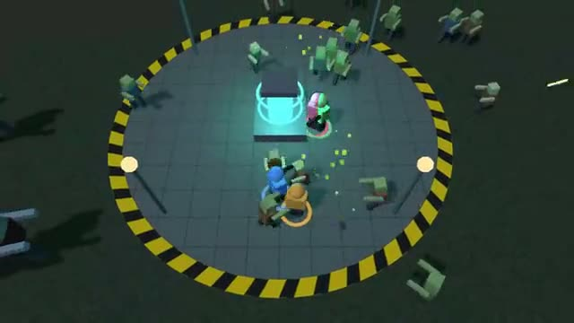

# Zombie Waves

Hold the base against bigger and bigger waves. A multiplayer starter game from [Multiplayer Agent](https://multiplayeragent.com): 3D, co-op, 1–4 players, with AI teammates that fill empty seats.

## How it plays

Zombies come from every side, more each wave, and go for the generator when nobody is in their way. Shoot them down, stand next to a friend who goes down to get them back up, and keep the generator running.

**Controls:** WASD and mouse, or two thumb sticks.

## Make it yours in the Game Builder

Open the [Game Builder](https://multiplayeragent.com), choose **Start from a starter game** and pick Zombie Waves. It opens as version 1 in your studio, ready to play and publish. Then ask for changes, for example:

- Add a boss zombie every fifth wave
- Let players build barricades between waves
- Make it aliens on a moon base

## Run it yourself

1. Get a free publishable key (`pk_…`) at [multiplayeragent.com](https://multiplayeragent.com).
2. In `index.html`, put it in place of `pk_REPLACE_ME` in the `MP_CONNECT` block.
3. Serve the folder (for example `npx serve`) and open it. The 3D engine loads as a module, which browsers block from a file on disk.

Without a key it still runs, offline with bot teammates.

## How it is built

- One `index.html` plus three.js in `libs/`. The comment at the top of the script maps the code and explains the multiplayer.
- **Leaderboard:** The highest wave each player reached.
- **Host-run rules:** The host's browser moves every zombie and runs the waves; if it leaves, the next player takes over.
- **Bots:** AI teammates fill the squad until enough people join.
- **Live sync:** Every survivor, zombie and shot shows up for everyone at once.
- `?attract` runs it offline with bots only. The preview video is recorded from it.

## License

MIT. three.js in `libs/` is MIT too (Copyright 2010-2024 three.js authors).
